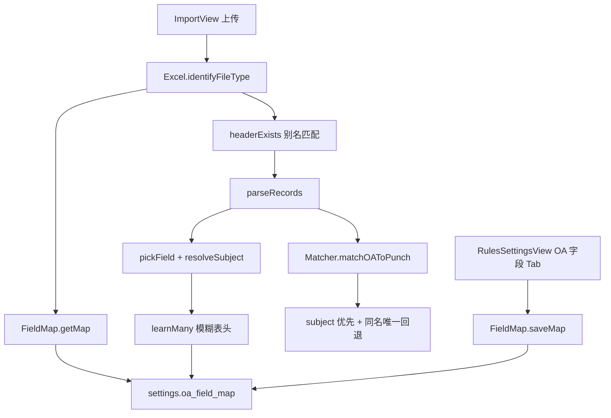

# V3.3 导入灵活性（OA 字段映射）

> 代码基线：`attendance-v3/client/src/shared/fieldMap.js`、`excel.js`、`matcher.js`、`RulesSettingsView.vue`。规格：`.monkeycode/specs/v3.3-import-flexibility/`。应用版本：`handlers/system.py` 的 `APP_VERSION = '3.3.0'`、`version_name = 'V3.3'`。

## 要解决的问题

V3.2 导入识别与标准化写死精确表头（去空白后 `headers.includes('请假类型')`、`clean['是否本人']`）。OA 导出改列名（`是否为本人`、`请假人`、`漏打卡日期`）或代他人申请时，类型识别失败，或 `subject` 落到申请人，考勤计算绑错人。

V3.3 抽成可配置 Field Map：别名、模糊匹配、导入自动学习、代申请按「是否本人 + 实际人员」解析 `subject`。排班仍按 Sheet 名 `^\d{1,2}月$` 识别，不读 Field Map。

## 数据流

解析仍在浏览器；入库仍是 `POST /api/attendance/import`。无 Field Map 专用 REST，走 `/api/store/settings`。

## Field Map 结构

`settings` 表键 `oa_field_map`（`OA_FIELD_MAP_KEY`）。`json_serialize` 会把 `value` 反序列成对象；`getMap` 同时兼容字符串。

| 键 | 含义 |
|----|------|
| `selfTrueValues` | 视为本人：默认 本人 / 是 / Y / YES / TRUE / 是本人 |
| `selfFalseValues` | 视为帮他人：默认 非本人 / 否 / N / NO / FALSE / 帮他人 / 代申请 / 其它 / 其他 / 其它人 / 其他人 / 帮其它人 |
| `types.punch` 等 | 内部字段 → 表头别名数组 |

`mergeFieldMap(saved)`：默认映射为底，已存非空数组覆盖对应字段。映射缺失或 JSON 损坏时回退默认。

## 表头打分

`normalizeHeader`：去空白。`compactHeader`：再去掉字符「是否为的了吧呢啊_-」。

| 条件 | 得分 |
|------|------|
| 去空白后完全相等 | 100 |
| compact 相等且长度 >= 2 | 80 |
| 前后缀包含 | 60 |
| compact 长度 >= 3 且前后缀包含 | 40 |

- 5 类 Excel 共用同一套方法：`headerExists` 识别类型、`pickField` 取值、`_pickPeople` 分流申请人。差异只在 `TYPE_IDENTIFY` / `RECORD_SCHEMA` / 各类型别名表，不写 5 套解析器
- `headerExists`：任一头得分 >= 40 视为命中（识别用）
- `pickField`：取最高分；同分优先非空单元格
- 自动学习：模糊命中且得分 >= 60，把实际表头插入该字段别名列表头部；精确匹配（100）不学习；写入失败不影响导入
- 重复表头：`uniquifyHeaders` 把第二列起写成 `申请人#2`。`pickApplicantAndOther`：第一列 → `applicant`，第二列 → 实际人员
- 「是否本人」为本人 → `subject` 取第一个申请人；为其它 / 帮他人 / 空 → 取第二个申请人

## 代申请 subject

`resolveSubject(isSelfRaw, applicant, otherPerson)`：

- `isSelfValue` 为 true（本人）→ `subject` = 第一个申请人
- 帮他人 / 其它 / 空串 → `subject` = 第二个申请人或 `subjectPerson`；空则回退申请人

OA 四类实际人员：请假/加班 `subjectPerson`；出差优先 `travelers` 再 `subjectPerson`；漏打卡 `subjectPerson`（同时写入 `missPerson` 与 `subject`）。

SQLite：`leave_records` / `overtime_records` / `travel_records` / `miss_punch_records` 均有 `isSelf`、`subject`（`TEXT NOT NULL DEFAULT ''`）。`database.py` `_migrate` 对旧库 `ALTER TABLE` 补列。

## OA 匹配考勤号

`Matcher.matchOAToPunch`：人员取 `rec.subject || rec.applicant`。

1. `name|department` 精确
2. 未命中且该姓名在员工表仅一条 → 用该考勤号（代申请部门常写成申请人部门）
3. 同名多人且部门对不上 → `employeeNo` 保持 `null`

## UI 与版本号

- 规则设置「OA 字段」Tab：视为本人 / 视为帮他人；子类型请假、漏打卡、加班、出差、打卡。保存后 `Excel._fieldMapCache = null`
- 导入预览表头用 `FIELD_LABELS` / `PREVIEW_LABELS` 中文（`applicant` → 申请人，`subject` → 实际人员）
- 登录页：`GET /api/system/version`（公开），展示 `{version_name} 考勤管理系统`
- 侧栏底部：`version_name` + `app_version` 第三段，默认 `V3.3.0`；品牌副标题 `Attendance V3.3`
- 系统设置「应用版本」：`V` + `status.app_version`

## 已知未做

- 导入预览不展示命中了哪列表头
- 无 Field Map 专用 REST
