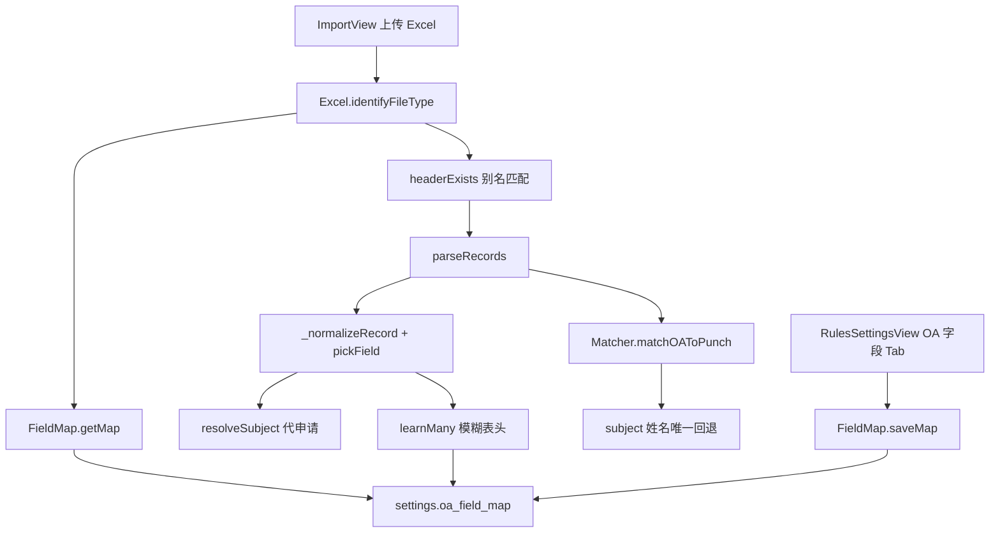

# V3.3 导入文件灵活性

Feature Name: v3.3-import-flexibility
Updated: 2026-10-10
Branch: `261008-feat-oa-field-map`

## Description

把 V3.2 导入链路中的**硬编码精确表头**抽成可配置 Field Map。识别、标准化、代申请主体、OA 匹配共用同一套别名与取值表。设置页可改请假/漏打卡/加班/出差别名；导入模糊命中后自动学习。排班识别不变。

对照 V3.2：`excel.js` 的 `identifyFileType` / `_normalizeRecord` 不再写死 `clean['请假类型']`；`matcher.js` 的 OA 匹配在姓名+部门之外增加同名唯一回退。

## Architecture



数据仍走 V3.2：前端解析 → `POST /api/attendance/import`。Field Map 存在 `settings` 表，经现有 `Store.getByKey` / `Store.put`（`/api/store/settings`）。无新后端 handler。

## Components and Interfaces

### `client/src/shared/fieldMap.js`（新建）

| 导出 | 职责 |
|------|------|
| `OA_FIELD_MAP_KEY` | `'oa_field_map'` |
| `DEFAULT_OA_FIELD_MAP` | 五类型默认别名 + `selfTrueValues` / `selfFalseValues` |
| `normalizeHeader` / `compactHeader` | 去空白；再去「是否为的了吧呢啊_-」 |
| `mergeFieldMap(saved)` | 默认底 + 已存非空数组覆盖 |
| `pickField(clean, aliases)` | 最高分表头取值；同分优先非空 |
| `uniquifyHeaders` / `pickApplicantAndOther` | 重复「申请人」列：第 1 列填单人，第 2 列被代申请人 |
| `labelForField` / `FIELD_LABELS` | 导入预览与设置页中文列名 |
| `headerExists(headers, aliases)` | 任一头得分 >= 40 |
| `isSelfValue` / `resolveSubject` | 本人/帮他人/其它判定与主体姓名 |
| `FieldMap.getMap` / `saveMap` / `learnMany` | settings 读写与别名前插学习 |

打分：精确 100；compact 相等且长度 >= 2 为 80；前后缀包含 60；compact 长度 >= 3 的前后缀包含 40。

### `client/src/shared/excel.js`

- `_getFieldMap()`：进程内缓存，`learnMany` / 设置页保存后置 `null`
- `identifyFileType`：`required` / `bonus` 改为别名数组 + `headerExists`
- `_normalizeRecord(row, fileType, fmap, learned)`：`pick(field)` 取值；OA 四类用 `resolveSubject`
- 模糊命中 score >= 60 推入 `learned`，`parseRecords` 结束调用 `FieldMap.learnMany`

### `client/src/shared/matcher.js`

`matchOAToPunch`：人员取 `rec.subject || rec.applicant`。先 `name|department`；未命中且该姓名在员工表仅一条时用该考勤号。

### `client/src/views/RulesSettingsView.vue`

新增 Tab `fields`。子类型：请假 / 漏打卡 / 加班 / 出差 / 打卡。保存走 `FieldMap.saveMap`，清 `Excel._fieldMapCache`。

## Data Models

`settings` 行：

```
key: "oa_field_map"
value: {
  selfTrueValues: ["本人", "是", "Y", "YES", "TRUE", "是本人"],
  selfFalseValues: ["非本人", "否", "N", "NO", "FALSE", "帮他人", "代申请", "..."],
  types: {
    punch: { employeeNo: ["考勤号码", "考勤号"], signIn: ["签到时间"], ... },
    leave: { leaveType: ["请假类型", "假别", "假期类型"], isSelf: ["是否本人", "本人申请"], subjectPerson: ["请假人员", ...], ... },
    overtime: { ... },
    travel: { ... },
    miss_punch: { missDate: ["忘打卡日期", "漏打卡日期", "补卡日期"], ... }
  }
}
```

`server.py` 的 `json_serialize` 会把 settings.value 反序列成对象；`getMap` 同时兼容字符串。

OA 标准化记录新增/沿用：

| 类型 | 关键字段 |
|------|----------|
| leave / overtime / travel / miss_punch | `applicant`, `isSelf`, `subject` |
| miss_punch | `missPerson` 与 `subject` 同源 |

## Correctness Properties

- 默认别名覆盖 V3.2 全部精确表头，旧模板导入结果与 V3.2 一致
- `mergeFieldMap(null)` 等于深拷贝 `DEFAULT_OA_FIELD_MAP`
- `isSelfValue('本人') === true`；`isSelfValue('帮他人') === false`；空串返回 `null`，`resolveSubject` 走实际人员
- 学习只追加未见过的表头，不删默认别名
- 同名多人且部门对不上时 `employeeNo` 保持 `null`（禁止误绑）

## Error Handling

| 场景 | 处理 |
|------|------|
| settings 读失败 / JSON 坏 | `mergeFieldMap(null)` |
| `learnMany` 写失败 | 吞掉，导入继续 |
| 设置页 `getMap` 失败 | 表单填默认映射 |
| 类型 unknown | 保持 V3.2：展示表头供确认 |

## Test Strategy

| 文件 | 覆盖 |
|------|------|
| `tests/field_map.mjs` | pickField 精确/模糊、headerExists、isSelfValue、resolveSubject、mergeFieldMap、Matcher 代申请按 subject 绑号 |
| `tests/test_field_map.py` | stub Store 后用 Node 跑 `field_map.mjs` |

回归：既有导入/计算/工作流测试仍应对 V3.2 标准表头全绿。

## Implementation Status

分支 `261008-feat-oa-field-map` 工作区已改、未 commit：

- 已改：`fieldMap.js`（新）、`excel.js`、`matcher.js`、`RulesSettingsView.vue`
- 已加测试：`tests/test_field_map.py`、`tests/field_map.mjs`

## References

- `.monkeycode/specs/v3.3-import-flexibility/requirements.md`
- `attendance-v3/client/src/shared/fieldMap.js`
- `attendance-v3/client/src/shared/excel.js` `identifyFileType` / `_normalizeRecord`
- `attendance-v3/client/src/shared/matcher.js` `matchOAToPunch`
- `.monkeycode/docs/专有概念/数据文件类型与格式.md`
